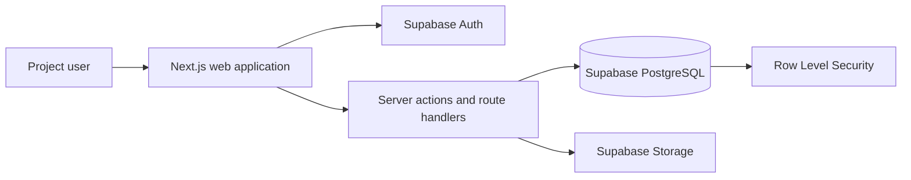

# System architecture

ConnectSphere starts as a modular monolith. One Next.js application contains the user interface and server-side business operations, while Supabase supplies authentication, PostgreSQL, file storage, and optional realtime events.

## Boundaries

- `src/app` is a thin delivery layer. Route groups separate public, authentication, and signed-in workspace pages without changing their URLs.
- `src/features` owns complete business capabilities: feature UI, validation, actions, queries, types, and framework-independent rules.
- `src/server` owns backend concerns shared across features, such as authenticated-user resolution, common authorization helpers, audit behaviour, and application errors.
- `src/lib/supabase` is the only direct Supabase client boundary.
- PostgreSQL constraints and RLS are the final integrity and authorization boundary.
- Cross-cutting audit and notification behaviour belongs in shared server modules, not UI components.

## Frontend and backend placement

| Responsibility                                   | Location                               |
| ------------------------------------------------ | -------------------------------------- |
| Routes and page composition                      | `src/app`                              |
| Shared interface elements                        | `src/components`                       |
| Feature-specific interface                       | `src/features/*/components`            |
| Validation and domain rules                      | `src/features/*/schemas` and `domain`  |
| Authenticated reads and writes                   | `src/features/*/queries` and `actions` |
| Shared server concerns                           | `src/server`                           |
| Authentication, shared data, RLS, and migrations | `src/lib/supabase` and `supabase`      |

## Request flow

1. Supabase Auth establishes the signed-in user.
2. A Server Component reads data or a Server Action or route handler validates a command.
3. The feature service checks workflow rules and invokes the Supabase client.
4. PostgreSQL constraints and RLS independently enforce integrity and authorization.
5. The action records status history or audit information and returns a typed result.
6. The page revalidates and shows a clear success or error state.

## Dependency order

Build vertical slices in this order: identity and roles; event schema and lifecycle; draft creation; submission and assignment; clarification; review and decision; arrangements. Venue, equipment, registration, and waitlist capabilities can build on the same event identity and lifecycle in later sprints.
