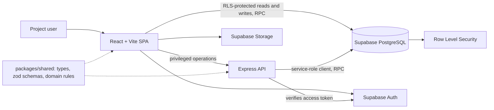

# System architecture

ConnectSphere is a modular monolith in a pnpm monorepo. A React single-page application and a thin Express API share one TypeScript package of types, validation and domain rules. One Supabase project supplies authentication, PostgreSQL and file storage. Business rules live in Postgres functions (RPC) protected by Row Level Security (RLS), so the database is the final authority on integrity and authorization.

The design is documented with the C4 model, as PlantUML sources: [system context](c4-context.puml), [containers](c4-container.puml) and [components](c4-component.puml). The API contract is [openapi.yaml](../api/openapi.yaml).

## Boundaries

- `apps/frontend/src/routes` holds pages and layouts. Each page is wrapped in a role gate; navigation and path rules per role come from `@spm/shared`.
- `apps/frontend/src/features/<feature>` owns a complete capability: components, services, hooks and utilities. Services are the only code that calls Supabase or the backend; components and pages call services.
- `apps/backend/src/routes` holds one router per capability. A route authenticates the caller (`requireAuth`), validates input with zod, calls a Postgres function with the service-role client, and maps database errors to HTTP errors.
- `packages/shared` holds types, zod schemas and domain logic used by both apps, so the browser and the API reject the same input.
- `supabase/migrations` holds the schema, RLS policies and business-rule functions. PostgreSQL constraints and RLS re-check everything the applications validate.
- Cross-cutting behaviour (status history, audit logs, notifications) is written inside security-definer functions, never by the client.

## Where responsibilities live

| Responsibility | Location |
| --- | --- |
| Pages, role gates and route composition | `apps/frontend/src/routes` |
| Feature UI, services and hooks | `apps/frontend/src/features/*` |
| Shared UI primitives | `apps/frontend/src/components/ui` |
| Validation rules (zod) and domain rules | `packages/shared/src/schemas`, `packages/shared/src/domain` |
| Privileged operations and HTTP error mapping | `apps/backend/src/routes` |
| Business rules, constraints, RLS, notifications | `supabase/migrations` |
| Database and RLS tests | `supabase/tests/database` |

## Request flow

1. Supabase Auth establishes the signed-in user and issues an access token.
2. For an ordinary read or write, a frontend service calls Supabase directly. RLS decides what the caller may see or change.
3. For a privileged operation, the service calls the Express API with the token. The route validates the input, re-checks that the caller may access the resource (the service-role client bypasses RLS), and calls a Postgres function.
4. The function enforces workflow rules in one transaction: allowed status transitions, venue availability using the venue's effective window (event time minus setup to event end plus turnaround), booking conflicts, and role checks.
5. The function records status history or audit information and creates any notifications.
6. The page shows a clear success or error state; `42501` becomes 403 and `23514` becomes 422 with field errors.

## Key design decisions

- [ADR 0001](adr/0001-modular-monolith.md): one deployable codebase organised into feature modules.
- [ADR 0002](adr/0002-supabase-native-data-access.md): Supabase migrations, generated types and `supabase-js`; no ORM.
- [ADR 0003](adr/0003-submission-through-backend.md): event submission runs in one Postgres transaction behind a backend route.
- Business rules in Postgres functions, with the status transition table mirrored in `packages/shared/src/domain/event-status.ts` so the UI and database agree.

## Feature areas

Event requests, review and coordination (including the Event Coordinator Lead's assignment queue); safety review; venue catalogue, blocks, availability, booking, holds and multi-venue bookings; equipment catalogue, availability and reservations; attendee registration and waiting list; notifications; supporting documents and banners in Storage. Venue, equipment and registration capabilities all build on the same event identity and lifecycle.
